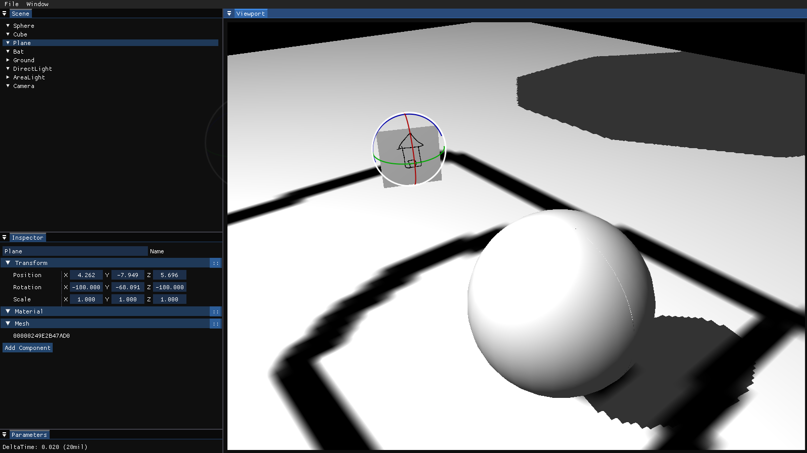

# RenderingEngine

My C++ render engine. Was implemented in order to learn Graphics Programming, OpenGL and GLSL language, as well as GPUs working cycle

# Build

Engine was tested on Fedora & Nix Linux and Windows

## Windows

You can use CLion or Visual Studio with Ninja for building

- Clone the repository: `git clone --recursive https://github.com/Arimekiku/RenderingEngine`
- Make sure you use Ninja generator
- Hit `F5 (Build button)` and wait

## Linux

To compile on x86_64-linux platform one can use nix or cmake.

### Nix

```shell
nix build "git+file://$(pwd)?submodules=1"
```

Argument "git+file://$(pwd)?submodules=1" is used due to the fact that this project uses git submodules.

### Cmake

```shell
mkdir build && cd build
cmake configure ..
make
```

Compile time dependencies for Ubuntu roughly specified in the [workflow](./.github/workflows/build-check-x86_64-linux.yaml).

# Features

## Preview



## Brief

This is improved version on my engine in which I implemented features I couldn't do a year ago. 
It has revamped textures, framebuffers and event systems, working skyboxes and very crude implementation of content browser. 

Engine was written fully in C++ as an educational project and has several features:

* Windowing
* VBO, VAO, EBO
* Mesh, Sprite, Framebuffer, Shader importer
* Scene system
* Guizmos and Mouse picking
* Very basic content browser
* Basic ECS
* Directional light shadow maps
